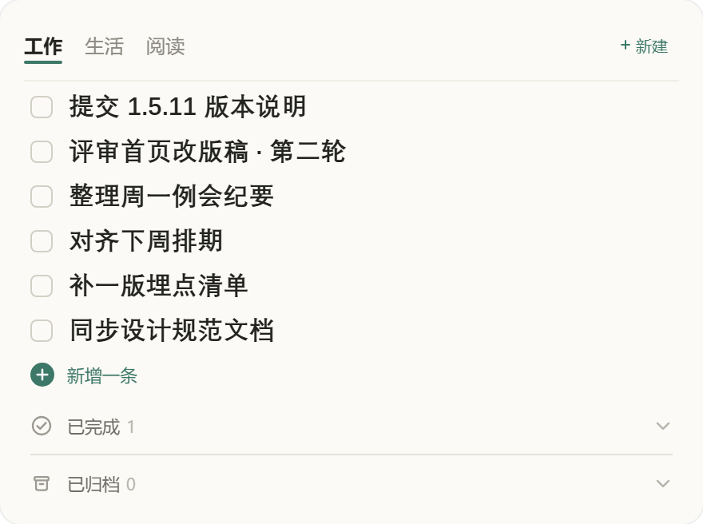

# Desk List

一个常驻 Windows 桌面的极简待办清单。位于所有窗口之下，默认不接收鼠标输入，仅在按住 `Ctrl` 时响应交互。

[English](README.md) · 简体中文



## 概述

Desk List 在桌面上呈现一张常驻的任务卡片。它不占用任务栏位置，不主动弹出，除查看之外无需任何操作。

由于默认忽略指针输入，它不会遮挡桌面图标或其他应用程序。按住 `Ctrl` 后界面浮现：分类页签、新增条目、已完成与已归档抽屉。

## 功能

- **桌面层级** —— 位于 Z 序最底部；鼠标输入穿透；不出现在任务栏与 `Alt+Tab` 中
- **按住 `Ctrl` 方可交互** —— 页签、新建、已完成与已归档抽屉随之浮现
- **`Ctrl+Alt+D`** —— 切换置顶态：卡片可点击并保持在其他窗口之上；再次按下恢复到桌面
- **`Ctrl+Alt+N`** —— 在任意程序中新建一条
- **托盘菜单** —— 显示、置顶、恢复到桌面、退出
- **分类与归档** —— 勾选的项目进入该分类的已完成列表；归档后清空
- **宽度可调** —— 拖动右边缘，320–520 px
- **界面语言** —— 默认跟随系统（中文 / English），设置里可切换，托盘菜单同步
- **本地存储** —— 单个 JSON 文件；无账号、无同步、无遥测

## 下载

Windows 10 / 11 (x64)，请从[最新发布](https://github.com/WoBok/desklist/releases/latest)获取：

- `DeskList-Setup-x.y.z.exe` —— 安装版，安装到当前用户，无需管理员权限
- `DeskList-x.y.z-Portable.exe` —— 单文件便携版，无需安装

## 从源码构建

需要 Rust 1.77+、Node 18+，以及 [Tauri 2 的前置依赖](https://tauri.app/start/prerequisites/)。

```bash
npm install
npx tauri build            # → src-tauri/target/release/desklist.exe
```

安装包由 `installer/setup.nsi` 生成。

## 说明

- 以 Windows 为主要平台。代码中保留 macOS 分支，但尚未验证。
- `tauri.conf.json` 中关闭了 GPU 合成（`--disable-gpu`）。在开发机上，透明窗口需关闭该项才能正常渲染；硬件加速正常的机器可移除这两个参数。
- 闲置开销：约 31 MB 内存，CPU 长期低于 0.1%。

## 许可证

MIT，详见 [LICENSE](LICENSE)。
